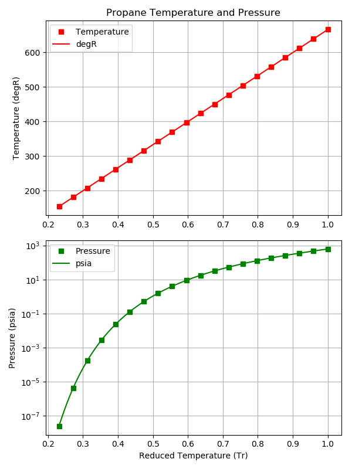
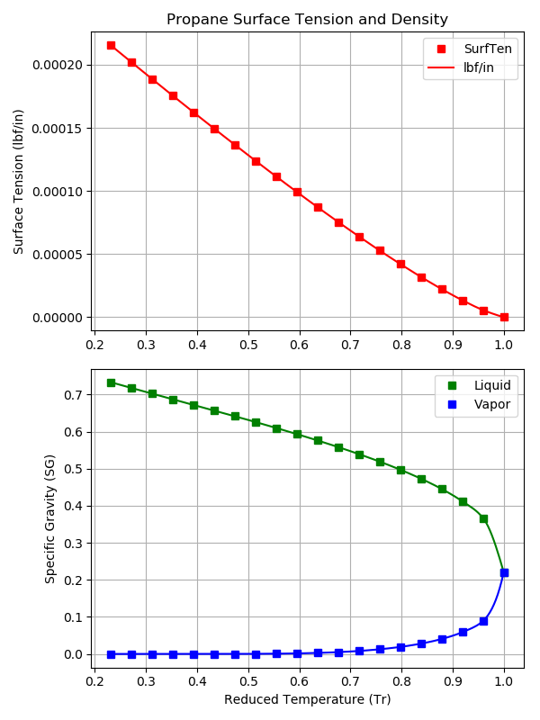
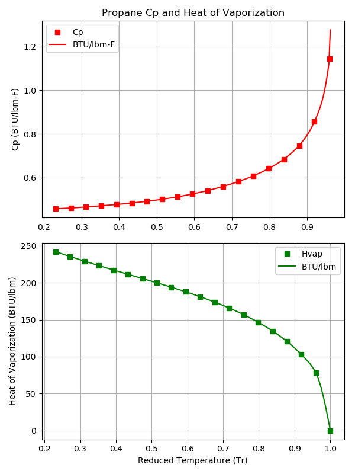
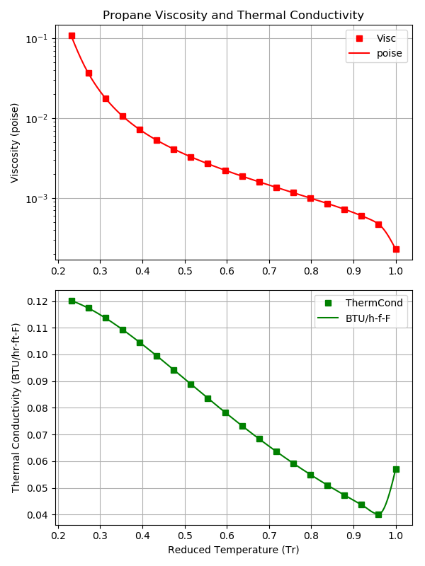

.. quickstart

QuickStart
==========

Install RocketProps
-------------------

The recommended way to install RocketProps is::

    pip install rocketprops
    
        OR on Linux
    sudo pip install rocketprops
        OR perhaps
    pip install --user rocketprops

Note that RocketProps relies on `scipy <https://www.scipy.org/getting-started.html>`_ which, 
in turn, depends on `numpy <https://numpy.org/doc/stable/reference/>`_ and 
`matplotlib <https://matplotlib.org/contents.html>`_.

.. _internal_source_install:

Installation From Source
------------------------

Much less common, but if installing from source, then
``pip`` is still a good option.

After navigating to the directory holding RocketProps source code, do the following::

    cd full/path/to/rocketprops
    pip install -e .
    
        OR on Linux
    sudo pip install -e .
        OR perhaps
    pip install --user -e .
    
This will execute the local ``setup.py`` file and install RocketProps.

Running RocketProps
-------------------

Test the installation by copying and pasting the following terminal command::

    python -c "from rocketprops.rocket_prop import get_prop; p=get_prop('N2O4'); p.summ_print()"

The output should be a table of properties like the following::

    ====== RocketProps State Point of Liquid N2O4 =====
    Name    =       N2O4  (MON-3, MON3)
    T       =       527.67 degR
    P       =      14.6959 psia
    Pvap    =      13.7843 psia
    Pc      =       1441.3 psia
    Tc      =       776.47 degR
    SGliq   =      1.44144 g/cc
    SGvap   =   0.00367439 g/cc
    visc    =   0.00420093 poise
    cond    =    0.0766961 BTU/hr/ft/delF
    Tnbp    =       530.07 degR
    Tfreeze =       471.42 degR
    Cp      =     0.374677 BTU/lbm/delF
    MolWt   =       92.011 g/gmole
    Hvap    =        178.2 BTU/lbm
    surf    =  0.000149673 lbf/in

Create Density Table
--------------------

.. code-block:: python

    from rocketprops.rocket_prop import get_prop
    from rocketprops.unit_conv_data import get_value

    propL = ['A50','Methane','CLF5','Ethane','Ethanol','F2','IRFNA','LOX','M20',
            'Methanol','MMH','MHF3','MON10','MON25','MON30','N2H4','N2O','N2O4',
            'NH3','PH2','Propane','UDMH','RP1','Water','H2O2',
            'Peroxide_70','Peroxide_85','Peroxide_95','Peroxide_100']

    dataD = {} # key=pname, value=(SGref, data string)

    print( '  Propellant  density     Tref       Tnbp     SGnbp')
    for pname in propL:
        pobj = get_prop( pname )
        Tref_C = get_value( pobj.T, 'degR', 'degC')
        Tnbp_C = get_value( pobj.Tnbp, 'degR', 'degC')
        SG_nbp = pobj.SGLiqAtTdegR( pobj.Tnbp )

        dataD[ pname ] = (pobj.SG, '%5.2f SG %8.1f \u00b0C'%( pobj.SG, Tref_C ) +\
                        '%8.1f \u00b0C %5.2f SG'%( Tnbp_C, SG_nbp ))
            
    keyL = sorted( dataD, key=dataD.get, reverse=True )
    for pname in keyL:
        print( '%12s'%pname, dataD[pname][1])

The output should be a table of densities like the following::

      Propellant  density     Tref       Tnbp     SGnbp
            CLF5  1.91 SG    -13.0 °C   -13.7 °C  1.91 SG
           IRFNA  1.58 SG     20.0 °C    64.4 °C  1.49 SG
              F2  1.50 SG   -188.1 °C  -188.1 °C  1.50 SG
            H2O2  1.45 SG     15.0 °C   150.2 °C  1.28 SG
    Peroxide_100  1.45 SG     15.0 °C   150.2 °C  1.28 SG
            N2O4  1.44 SG     20.0 °C    21.3 °C  1.44 SG
           MON10  1.42 SG     20.0 °C     9.7 °C  1.44 SG
     Peroxide_95  1.40 SG     20.0 °C   145.7 °C  1.26 SG
           MON25  1.39 SG     20.0 °C    -9.4 °C  1.45 SG
           MON30  1.38 SG     20.0 °C   -16.1 °C  1.46 SG
     Peroxide_85  1.36 SG     20.0 °C   137.4 °C  1.23 SG
     Peroxide_70  1.29 SG     20.0 °C   125.5 °C  1.19 SG
             N2O  1.23 SG    -88.5 °C   -88.5 °C  1.23 SG
             LOX  1.14 SG   -183.0 °C  -183.0 °C  1.14 SG
            N2H4  1.01 SG     20.0 °C   114.2 °C  0.92 SG
           Water  1.00 SG     20.0 °C   100.0 °C  0.96 SG
             M20  0.98 SG     20.0 °C   108.2 °C  0.90 SG
             A50  0.90 SG     20.0 °C    70.0 °C  0.86 SG
            MHF3  0.89 SG     20.0 °C    89.7 °C  0.83 SG
             MMH  0.88 SG     20.0 °C    87.7 °C  0.81 SG
             RP1  0.81 SG     20.0 °C   216.7 °C  0.65 SG
        Methanol  0.79 SG     20.0 °C    64.5 °C  0.75 SG
            UDMH  0.79 SG     20.0 °C    62.3 °C  0.75 SG
         Ethanol  0.79 SG     20.0 °C    78.2 °C  0.74 SG
             NH3  0.68 SG    -33.3 °C   -33.3 °C  0.68 SG
         Propane  0.58 SG    -42.1 °C   -42.1 °C  0.58 SG
          Ethane  0.54 SG    -88.6 °C   -88.6 °C  0.54 SG
         Methane  0.42 SG   -161.5 °C  -161.5 °C  0.42 SG
             PH2  0.07 SG   -252.9 °C  -252.9 °C  0.07 SG

Create Quick Plots
------------------

The following example will generate plots for Propane (C3H8) of its various liquid properties as a function of reduced temperature (Tr = T/Tc).

.. code-block:: python

    from rocketprops.rocket_prop import get_prop

    p = get_prop('c3h8')
    p.plot_sat_props(save_figures=True)

