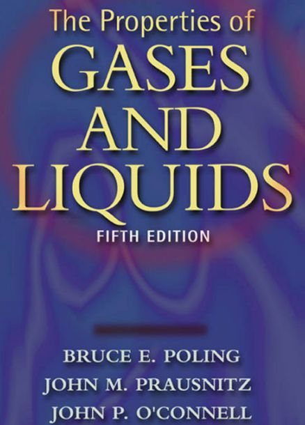
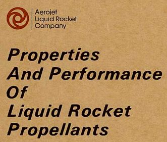
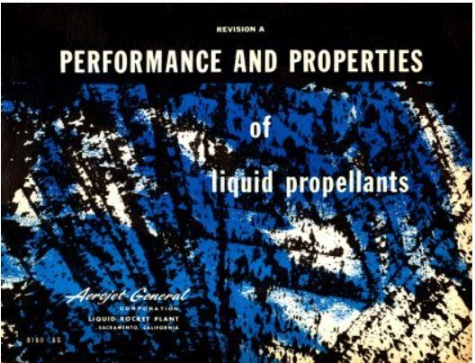
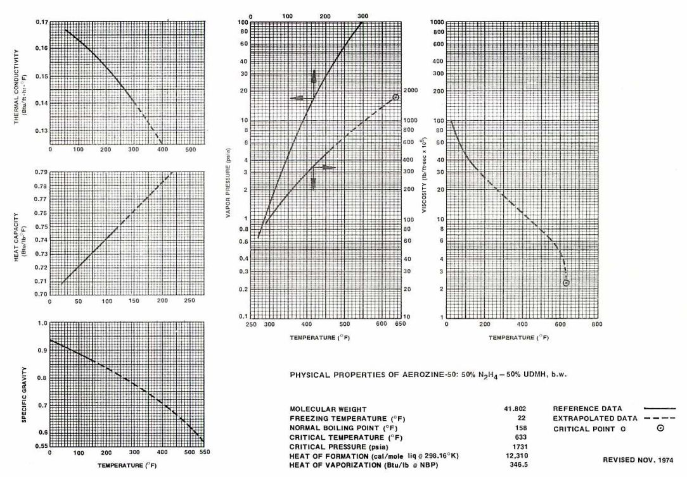
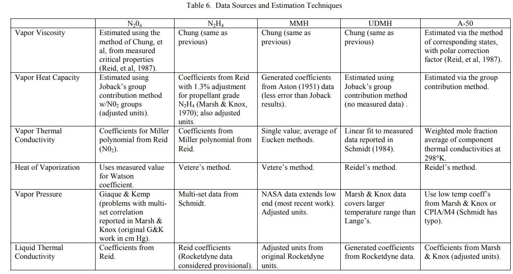

.. sources

Sources
=======

The following are the sources used to create this propellant properties database.

.. _Gas&Liq 5th Ed:

.. _Gas&Liq 5th Ed Source:

Gas&Liq 5th Ed
--------------

`Properties of Gases and Liquids, Fifth Edition <https://www.accessengineeringlibrary.com/content/book/9780070116825>`_,
also available as a
`PDF <file:///D:/downloads/sweet.ua.pt_fsilva_PTDCFTT2980_Reidetal.2001ThePropertiesofGasesandLiquids.pdf>`_,
is an all-inclusive, critical survey of the most reliable estimating methods in use 
today written and organized by Bruce Poling, John Prausnitz, and John O'Connell.

Areas covered include pure component constants; thermodynamic properties of ideal gases, 
pure components and mixtures; pressure-volume-temperature relationships; 
vapor pressures and enthalpies of vaporization of pure fluids; fluid phase equilibria 
in multicomponent systems; viscosity; thermal conductivity; diffusion coefficients; 
and surface tension.

For this project, 
`Properties of Gases and Liquids, Fifth Edition <https://www.accessengineeringlibrary.com/content/book/9780070116825>`_,
is being used to select recommended models for each of the fluid properties (vapor pressure, density, viscosity, etc.).

.. _RefProp Source:

RefProp
-------

`REFPROP <https://www.nist.gov/srd/refprop>`_
is software created by the 
`National Institute of Standards and Technology (NIST) <https://www.nist.gov/>`_.
It calculates the thermodynamic and transport properties of industrially 
important fluids and their mixtures. REFPROP  is  an  acronym  for  
REFerence  fluid  PROPerties.

The version of RefProp used to generate the data here is from 2007, not the most
current version of REFPROP.

As of this writing, the current version, Version 10.0, includes 147 pure fluids.
Of interest here are: ammonia, methane, ethane, propane, fluorine, oxygen, 
normal hydrogen, parahydrogen,  ethanol, methanol, nitrous oxide.

From 2012, there are some unofficial property files for hydrazine and
monomethylhydrazine as well as from 2008, an unofficial file for RP1.

Bear in mind that REFPROP uses the most accurate nist-equations of state 
and models currently available, but it is not fluid data.
It generalizes fluid data by the most accurate methods currently available.

.. _CoolProp Source:

CoolProp
--------

`CoolProp <http://www.coolprop.org/index.html#what-is-coolprop>`_
is an open source C++ library with a `python <https://www.python.org>`_
interface to calculate state-of-the-art 
formulations of fluid thermophysical properties. As of this writing, 
110 pure and pseudo-pure fluids are included in the library, 
as well as properties of 40 incompressible fluids

Of interest here are: methane, ethane, fluorine, methane, oxygen, 
hydrogen, parahydrogen,  ethanol, methanol, nitrous oxide, ammonia.

.. _thermo Source:

thermo
------

`thermo <https://pypi.org/project/thermo/>`_ is an open-source 
project on `pypi.org <https://pypi.org/>`_ developed by Caleb Bell 
and Contributors (2016-2020). 

The github source code of
thermo is described as:
Chemical properties component of Chemical Engineering Design Library (ChEDL)
and is accessible at:
`https://github.com/CalebBell/thermo <https://github.com/CalebBell/thermo>`_.

It facilitates the retrieval of constants of chemicals, 
the calculation of temperature and pressure dependent chemical properties 
(both thermodynamic and transport), the calculation of the same for chemical mixtures 
(including phase equilibria), and assorted information of a regulatory or 
legal nature about chemicals.

.. _Aerojet Source:

Aerojet
-------

In the mid 1970's 
`Aerojet Liquid Rocket Company (ALRC) <https://en.wikipedia.org/wiki/Aerojet>`_, now known as
`Aerojet Rocketdyne <https://www.rocket.com/>`_,
published an internal book of
propellant properties (brown image below). This was largely an updated
and corrected reprint of a previous
publication by Aerojet General in 1961 (blue cover below).

The `ALRC book <./_static/Aerojet_Propellant_Properties.pdf>`_ contains graphs 
of thermal conductivity, heat capacity, specific gravity,
vapor pressure and viscosity. Also included are tables of molecular weight, freezing 
temperature, normal boiling point, critical temperature, critical pressure, heat of
vaporization and heat of formation.

Many of the graphs of propellant properties in the ALRC book were 
`digitized <https://digiplot.readthedocs.io/en/latest/>`_ and used as
property correlations in this project.

An example page for Aerozine-50 is shown below.

.. _CRC_ChemPhysHandbook:

.. _CRC_ChemPhysHandbook Source:

CRC Handbook
------------

The 84th Edition of the CRC Handbook of Chemistry and Physics (2003–2004), 
edited by David R. Lide, is a definitive one-volume reference for scientists and engineers. 
This edition remains a cornerstone for propellant researchers because it provides 
the standardized physical constants required for high-accuracy modeling.

.. _AFRPL-TR-67-144 Source:

AFRPL-TR-67-144
---------------

AFRPL-TR-67-144 is the USAF Hydrogen Peroxide Handbook authored by the Rocketdyne Division of North American Aviation. 

See: `AFRPL-TR-67-144 PDF <./_static/AFRPL_TR_67_144_peroxide_1967.pdf>`_

It compiles decades of research—including the work of Schumb and Satterfield 
(The recognized authorities on hydrogen peroxide during the mid-20th century)

.. _Schumb-MIT Source:

.. _Schumb-MIT:

ASTIA Report No. 43
-------------------

ASTIA (Armed Services Technical Information Agency)

This report represents a critical intermediate stage in the development of the 
1955 ACS Monograph Schumb, W. C., Satterfield, C. N., & Wentworth, R. L. (1955).
“Hydrogen Peroxide”.

Titled “Hydrogen Peroxide, Part Two,” it was issued in 1953 by the MIT 
Hydrogen Peroxide Laboratories under the sponsorship of the Office of Naval Research.

It provides the experimental results and recommended values for density, viscosity, 
surface tension, and vapor pressure.

See: `ASTIA Report 43 PDF <./_static/ASTIA_hydrogen_peroxide_Schumb_et_al_1953.pdf>`_

The 1955 Monograph itself: 

   Schumb, W. C., Satterfield, C. N., & Wentworth, R. L. (1955). 
   Hydrogen Peroxide. American Chemical Society Monograph Series, No. 128. New York: Reinhold Publishing Corporation.

must be purchased, however a preview is available at `HathiTrust Digital Library <https://www.hathitrust.org/>`_ for:

   `Monograph Cover Page <https://babel.hathitrust.org/cgi/pt?id=mdp.39015003708784&seq=7>`_

   `Physical Properties Chapter 5 <https://babel.hathitrust.org/cgi/pt?id=mdp.39015003708784&seq=209>`_

.. _AFRPL-TR-69-149 Source:

AFRPL-TR-69-149
---------------

AFRPL-TR-69-149 is the USAF Propellant Handbooks Hydrazine Fuels Volume I.

See: `AFRPL-TR-69-149 PDF <./_static/AFRPL-TR-69-149Hydrazine_fuels.pdf>`_

Or: `AFRPL-TR-69-149 at National Technical Reports Library <https://ntrl.ntis.gov/NTRL/dashboard/searchResults/titleDetail/AD507864.xhtml#:~:text=The%20Hydrazine%20Fuels%20Handbook%20is,of%20fuels%20and%20their%20blends.>`_

Published by Bell Aerospace Company in 1970 it was
prepared for the Air Force Rocket Propulsion Laboratory (AFRPL) and covers
the properties of a variety of amine rocket fuels including:
ammonia, Aerozine-50, hydrazine, UDMH, MMH and MHF3.

.. _AFRPL-TR-76-76 Source:

AFRPL-TR-76-76
--------------

AFRPL-TR-76-76 is the USAF Propellant Handbooks Nitric Acid/Nitrogen Tetroxide Oxidizers Vol II.

See: `AFRPL-TR-76-76 PDF  <./_static/AFRPL-TR_76-76_MON_propellants.pdf>`_

Or: `AFRPL-TR-76-76 at Defense Technical Information Center <https://apps.dtic.mil/dtic/tr/fulltext/u2/a036741.pdf>`_

Published by Martin Marietta Corporation, Denver Division in 1977 it was
prepared for the Air Force Rocket Propulsion Laboratory (AFRPL) and covers,
"Properties and Logistics",
"Handling, Storage and Compatibility" and
"Safety" for Nitric Acid and Nitrogen Tetroxide.

It includes some data for 
`Mixed Oxides of Nitrogen <https://en.wikipedia.org/wiki/Mixed_oxides_of_nitrogen>`_ , 
MON10, MON25 and MON30
for which 10%, 25% and 30% of Nitric oxide (NO) is added to N2O4 by weight.

.. _Vandenberg Source:

.. _CPIA-LPM Source:

CPIA-LPM
--------

`Unit 29 of the CPIA-LPM Manual <./_static/MON-Mixed_Oxides_of_Nitrogen.pdf>`_
includes a section on Mixed Oxides of Nitrogen (MON).

It focuses on MON10, MON25 and MON30.

Vandenberg
----------

Due to significant omissions and errors in published propellant properties, a
`Vandenberg Update <https://www.researchgate.net/publication/294263780_Physical_Thermodynamic_Properties_of_Hypergolic_Propellants_A_Review_and_Update>`_
was published in 1999.

The methods used to try and resolve some of these errors included 
(1) a comparison of various literature values, including an assessment of data quality, 
to determine whether reported values were measured or estimated, 
(2) a derivation of temperature dependent correlation coefficients 
and validation with independent measurements 
(where sufficient measured data were available), and 
(3) an estimation of the missing parameters using modern techniques 
such as the method of corresponding states or group contribution methods. 
Utilizing these methods resulted in a validated set of properties 
(many as functions temperature) for hypergolic propellants, which are
suitable for environmental modeling applications and more general engineering calculations.
The complete parameter set is provided, along with references and examples 
illustrating the above methods. Also, mixing rules, pseudo-critical properties, 
and mixture properties are provided for a nominal composition Aerozine-50 mixture.

.. note::

   The density equation for N2H4 is clearly incorrect as published. Almost certainly, the 1st coefficient of 
   the density equation should be 1.2492 instead of the published 1.02492. This correction has been made for
   N2H4 in this project.
   
   Also note that the equation for thermal conductivity of N2H4 gives values higher than other references
   by about a factor of 2.
   

Within this document, the data sources are:

.. _Rocketdyne Source:

Rocketdyne
----------

Rocketdyne, now known as `Aerojet Rocketdyne <https://www.rocket.com/>`_,
published a document called **ENGINEERING PROPERTIES OF ROCKET PROPELLANTS**
for the Air Force Rocket Propulsion Laboratory (AFRPL) in 1973.

It is Report Number `AFRPL-TR-73-105 <./_static/Rocketdyne_N2O4.pdf>`_
and includes data for a number of propellants.

.. _NIST Webbook:

NIST Webbook
------------

`NIST Chemistry WebBook <https://webbook.nist.gov/chemistry/>`_
provides thermochemical, thermophysical, and ion energetics data compiled by NIST under the Standard Reference Data Program. 
The National Institute of Standards and Technology (NIST) uses its best efforts to deliver 
a high quality copy of the Database and to verify that the data contained therein have been 
selected on the basis of sound scientific judgment. 

NIST is an agency of the U.S. Department of Commerce. 

The NIST Chemistry WebBook was developed in part with funds from the 
Systems Integration for Manufacturing Applications (SIMA) program at NIST. 

.. _Gemini Source:

Gemini
------

`Gemini <https://gemini.google.com/>`_  was used to source data for peroxide (H2O2)

Gemini provided physical property data for High Test Peroxide (HTP) at varying 
concentrations. Data includes density, viscosity, phase change boundaries, and 
safety thresholds.

Schumb, W. C., Satterfield, C. N., & Wentworth, R. L. (1955). 
*Hydrogen Peroxide*. ACS Monograph Series, Reinhold Publishing Corp. 
(Primary source for Density, Viscosity, and Phase Change).

NIST Chemistry WebBook (SRD 69). "Hydrogen Peroxide". 
(Source for Critical Properties and Vapor Pressure correlations).

NASA/TM—2004-213129. *Liquid Rocket Propellant Properties*. 
(Source for Safety Data, Onset Temperatures, and Heat of Vaporization).

FMC Corporation / PeroxyChem Technical Manuals. 
(Industry standard data for HTP handling and Storage Stability).

.. _Copilot Source:

Copilot
-------

`Copilot <https://copilot.microsoft.com/>`_ was used to source data for peroxide (H2O2) from the following sources.

Bureau of Mines

The U.S. Bureau of Mines was a federal agency (established in 1910 and 
operating until 1996) that conducted research on mining, mineral processing, 
and materials science. It was known for:

- Publishing comprehensive data on mineral properties and production
- Conducting technical research on various chemicals and materials
- Producing technical reports and databases on industrial chemicals like hydrogen peroxide
- Being a primary source for industrial chemical specifications and safety data
    

USP Technologies

USP Technologies is a major global producer and supplier of hydrogen peroxide and other specialty chemicals. They are known for:

- Manufacturing high-purity hydrogen peroxide for industrial applications
- Providing technical documentation and specifications for H2O2 products
- Being a leading source for peroxide data in industrial contexts
- Supplying various grades of hydrogen peroxide (from industrial to semiconductor-grade purity)

